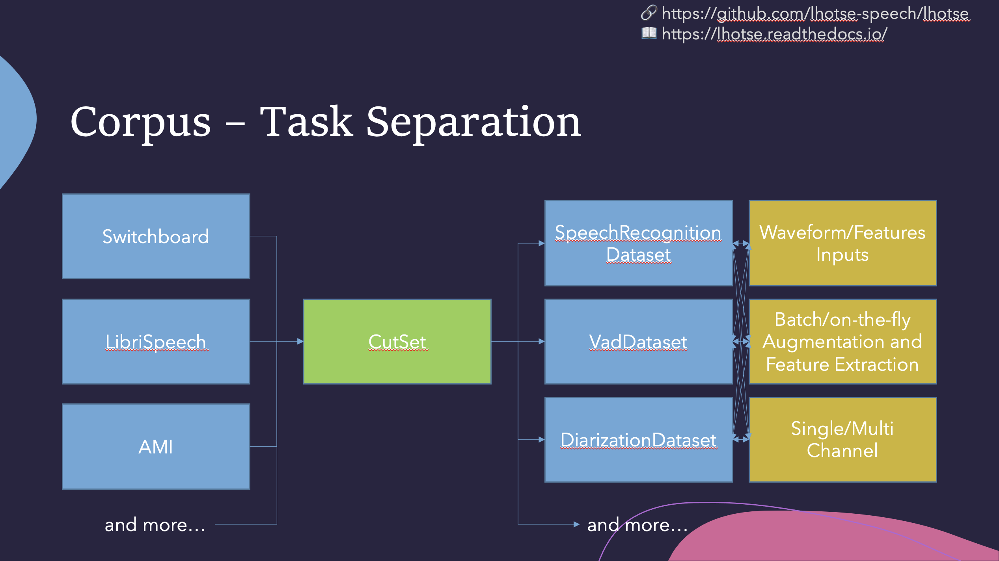
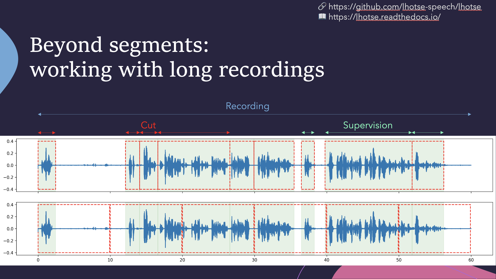

<div align="center">


[](https://pypi.org/project/lhotse/)
[](https://github.com/lhotse-speech/lhotse/actions/workflows/unit_tests.yml)
[](https://pepy.tech/projects/lhotse)
[](https://github.com/lhotse-speech/lhotse/actions/workflows/unit_tests.yml)
[](https://lhotse.readthedocs.io/en/latest/)
[](https://codecov.io/gh/lhotse-speech/lhotse)
[](https://github.com/psf/black)
[](https://colab.research.google.com/github/lhotse-speech/lhotse/blob/master/examples/00-basic-workflow.ipynb)
[](https://arxiv.org/abs/2110.12561)

</div>

# Lhotse

Lhotse is a Python library for preparing multimodal datasets and building scalable
PyTorch data pipelines. It provides manifests for audio, video, images, and text,
on-the-fly augmentation, dynamic batching, efficient sharded storage, and indexed,
resumable dataloading.

[Documentation](https://lhotse.readthedocs.io/en/latest/) ·
[Quick start](#quick-start) · [Tutorials](#tutorials) ·
[Contributing](#development-installation) · [Citation](#citation)

## Installation

Install the latest stable release from [PyPI](https://pypi.org/project/lhotse/):

```bash
python -m pip install lhotse
```

This README and the `latest` documentation describe the development version on
`master`, which requires **Python 3.11 or later**. Some APIs and extras described
below may not yet be available in the stable release. The Python badge above
lists the versions tested on `master`; check PyPI for the stable release's requirements.

To use the development version:

```bash
python -m pip install git+https://github.com/lhotse-speech/lhotse
```

PyTorch is required; torchaudio and TorchCodec 0.10 or later are optional audio
backends. TorchCodec also reads video (`python -m pip install torchcodec`) and
requires an FFmpeg version that it supports.
See [optional dependencies](#optional-dependencies) for additional formats and
integrations.

## Quick start

Download the small public [YesNo corpus](https://www.openslr.org/1/), prepare its
training split, and load a batch of audio and transcripts. This example uses
waveforms directly, so it does not need precomputed features or worker processes.

```python
from pathlib import Path

from torch.utils.data import DataLoader

from lhotse import CutSet
from lhotse.dataset import (
    AudioSamples,
    DynamicCutSampler,
    K2SpeechRecognitionDataset,
)
from lhotse.recipes import download_yesno, prepare_yesno

corpus_dir = download_yesno(target_dir=Path("data"))
manifests = prepare_yesno(corpus_dir=corpus_dir)["train"]
cuts = CutSet.from_manifests(
    recordings=manifests["recordings"],
    supervisions=manifests["supervisions"],
    output_path=Path("data") / "cuts.jsonl.gz",
    lazy=True,
)

dataset = K2SpeechRecognitionDataset(input_strategy=AudioSamples())
sampler = DynamicCutSampler(cuts, max_duration=60, shuffle=False)
dataloader = DataLoader(dataset, sampler=sampler, batch_size=None)
batch = next(iter(dataloader))

print(batch["inputs"].shape)  # Padded waveforms: (batch, samples).
print(batch["supervisions"]["text"])
```

The cuts are saved as a JSONL manifest and opened lazily, without loading their
audio into memory. `DynamicCutSampler` streams the cuts into batches with at most
60 seconds of audio, and the dataset loads and pads their waveforms when requested.
Despite its name, `K2SpeechRecognitionDataset` does not require k2.

## Key features

- **Multimodal manifests:** represent recordings, supervision segments, images,
  and audio/video cuts in human-readable manifests with Python and CLI APIs.
- **Lazy processing:** stream large JSONL manifests and compose filtering,
  mapping, shuffling, and dataset blending without loading everything into memory.
- **On-the-fly transforms:** truncate, pad, mix, and augment cuts while adjusting
  their supervision timing; compute features during loading or store them in advance.
- **Dynamic batching:** group examples by duration and use dynamic bucketing to
  reduce padding. Partition data across distributed ranks and dataloader workers
  to avoid overlapping samples.
- **Efficient storage:** use [Lhotse Shar](https://lhotse.readthedocs.io/en/latest/api.html#lhotse.shar.writers.SharWriter)
  for modular, sharded sequential I/O from local or remote storage.
- **Indexed and resumable dataloading:** index JSONL and Shar data, pack shard
  indexes into `.idxpack` catalogs, and checkpoint supported iterator pipelines.
  See [indexed manifests](https://lhotse.readthedocs.io/en/latest/indexed-manifests.html)
  for the requirements for exact restore, including gzip indexes and worker state.
- **Corpus recipes:** prepare standard manifests for
  [commonly used datasets](https://lhotse.readthedocs.io/en/latest/corpus.html#standard-data-preparation-recipes).

## Tutorials

The notebooks in [`examples`](https://github.com/lhotse-speech/lhotse/tree/master/examples)
cover the following workflows. Open them on GitHub to read them or in Colab to run
them; installation and data requirements are described in each notebook.

| Tutorial | Run |
| --- | --- |
| [Basic Lhotse workflow](https://github.com/lhotse-speech/lhotse/blob/master/examples/00-basic-workflow.ipynb) | [Colab](https://colab.research.google.com/github/lhotse-speech/lhotse/blob/master/examples/00-basic-workflow.ipynb) |
| [Transforming data with cuts](https://github.com/lhotse-speech/lhotse/blob/master/examples/01-cut-python-api.ipynb) | [Colab](https://colab.research.google.com/github/lhotse-speech/lhotse/blob/master/examples/01-cut-python-api.ipynb) |
| [WebDataset integration](https://github.com/lhotse-speech/lhotse/blob/master/examples/02-webdataset-integration.ipynb) | [Colab](https://colab.research.google.com/github/lhotse-speech/lhotse/blob/master/examples/02-webdataset-integration.ipynb) |
| [Combining multiple datasets](https://github.com/lhotse-speech/lhotse/blob/master/examples/03-combining-datasets.ipynb) | [Colab](https://colab.research.google.com/github/lhotse-speech/lhotse/blob/master/examples/03-combining-datasets.ipynb) |
| [Lhotse Shar: modular data format](https://github.com/lhotse-speech/lhotse/blob/master/examples/04-lhotse-shar.ipynb) | [Colab](https://colab.research.google.com/github/lhotse-speech/lhotse/blob/master/examples/04-lhotse-shar.ipynb) |
| [Image and video loading](https://github.com/lhotse-speech/lhotse/blob/master/examples/05-image-and-video-loading.ipynb) | [Colab](https://colab.research.google.com/github/lhotse-speech/lhotse/blob/master/examples/05-image-and-video-loading.ipynb) |
| [AIStore batch loading](https://github.com/lhotse-speech/lhotse/blob/master/examples/06-train-ais-batch.ipynb) (requires an AIStore endpoint) | [Colab](https://colab.research.google.com/github/lhotse-speech/lhotse/blob/master/examples/06-train-ais-batch.ipynb) |
| [Resumable, indexed dataloading](https://github.com/lhotse-speech/lhotse/blob/master/examples/07-resumable-indexed-dataloading.ipynb) (`torchdata` for the optional multi-worker example) | [Colab](https://colab.research.google.com/github/lhotse-speech/lhotse/blob/master/examples/07-resumable-indexed-dataloading.ipynb) |

The video notebook reads video frames and audio tracks with TorchCodec 0.10 or
later, which also requires FFmpeg. The AIStore notebook uses 100 training and
20 development recordings and creates and removes its own temporary bucket.

### Tutorial presentations and materials

These conference materials provide additional background and may use older APIs:

- Interspeech 2023: [tutorial notebook](https://colab.research.google.com/drive/1obZjUuVwks3A4oFX3gXFtPOM2LtrPQfL?usp=sharing)
  and [slides (Microsoft sign-in required)](https://livejohnshopkins-my.sharepoint.com/:p:/g/personal/mwiesne2_jh_edu/EYqRDl8cIr5BsVDxi1MOW5EBUpdqh10WFkzqixPIFM63hg?e=u3lrmL).
- Interspeech 2021: [recorded lecture (3 hours)](https://www.youtube.com/watch?v=y6CJLFQlmhc).

## Examples of use

- [Icefall](https://github.com/k2-fsa/icefall): speech recognition recipes combining
  Lhotse data pipelines with [k2](https://github.com/k2-fsa/k2).
- [NVIDIA NeMo](https://docs.nvidia.com/nemo/speech/nightly/dataloaders.html):
  Lhotse dataloading with dynamic batching, dataset mixing, and Shar support.
- [ESPnet example](https://colab.research.google.com/drive/1HKSYPsWx_HoCdrnLpaPdYj5zwlPsM3NH):
  a minimal integration notebook (Google sign-in may be required).

Lhotse shares its roots with [Kaldi](https://github.com/kaldi-asr/kaldi) and
supports [importing and exporting Kaldi data](https://lhotse.readthedocs.io/en/latest/kaldi.html).

## Main ideas

`RecordingSet` describes recordings, `SupervisionSet` describes annotations such
as transcripts and speakers, and `CutSet` combines them into examples that can be
reshaped for training. Manifests store metadata and references to the underlying
data; audio transforms are applied when the data is loaded.



Cuts support mixing, truncation, padding, and augmentation. Feature extraction
can run on the fly or ahead of training, with optional compressed storage.
Lhotse also supports mixing features directly.



## Optional dependencies

Install only the extras needed for your workflow. These extras describe `master`;
when using development-only features, include the extras in the source install:

```bash
python -m pip install 'lhotse[checkpoint,gzip] @ git+https://github.com/lhotse-speech/lhotse'
```

For a published extra, use a quoted requirement such as
`python -m pip install "lhotse[lilcom]"`.

| Extra | Enables |
| --- | --- |
| `checkpoint` | `torchdata.stateful_dataloader.StatefulDataLoader` for multi-worker checkpointing. |
| `gzip` | Indexed gzip JSONL with `indexed_gzip`; keep both `.idx` and `.gzidx` sidecars. |
| `lilcom` | Compressed features and arrays; `lilcom_chunky` is the preferred compressed feature backend. |
| `orjson` | Faster JSONL serialization and reading. |
| `webdataset` | WebDataset import/export. |
| `pillow` | Image loading with Pillow. |
| `aistore` | AIStore I/O and batch loading; configure `AIS_ENDPOINT`. |
| `kaldi` | Kaldi I/O and feature extraction via `kaldi-native-io` and `kaldifeat`. |
| `h5py` | HDF5 feature storage. |
| `dill` | Serialization of lazy transforms such as lambdas across processes. Also set `LHOTSE_DILL_ENABLED=1` or call `lhotse.set_dill_enabled(True)`. |

Additional audio backends, remote storage clients, feature extractors, and
SPHERE support are covered in the
[installation reference](https://lhotse.readthedocs.io/en/latest/getting-started.html#optional-dependencies).

### Environment variables

See the [configuration reference](https://lhotse.readthedocs.io/en/latest/getting-started.html#environment-variables)
for audio and I/O backend selection, timing tolerances, remote storage settings,
and serialization options. Dill is disabled by default even when installed;
enabling it can help with lazy transforms in a PyTorch `DataLoader` with
`num_workers > 0`.

### Development installation

Clone the repository, then install the locked development environment with
[uv](https://docs.astral.sh/uv/getting-started/installation/):

```bash
git clone https://github.com/lhotse-speech/lhotse
cd lhotse
uv sync --locked
uv run --locked pre-commit install
```

See the [contributor guide](https://lhotse.readthedocs.io/en/latest/contributing.html)
for the required uv version, system dependencies, tests, formatting, documentation
builds, CPU/CUDA environments, dependency updates, and releases.

## Citation

If you use Lhotse in research, please cite
[Lhotse: a speech data representation library for the modern deep learning ecosystem](https://arxiv.org/abs/2110.12561)
(NeurIPS Data-Centric AI Workshop, 2021). Citation metadata is available in
[`CITATION.cff`](https://github.com/lhotse-speech/lhotse/blob/master/CITATION.cff).

## Acknowledgment

Some contributions to this project were supported by National Science Foundation
CCRI award 2120435.
