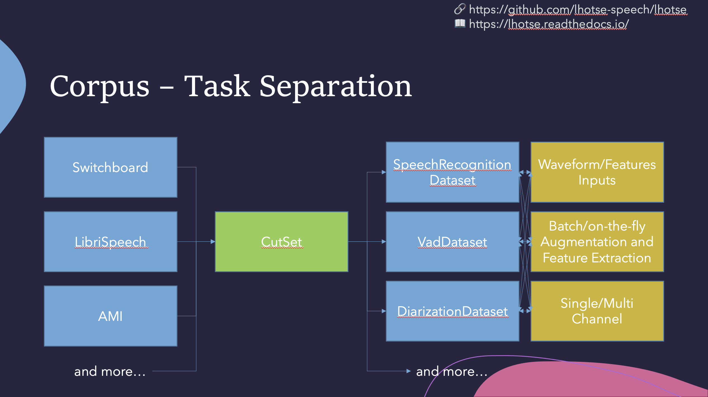
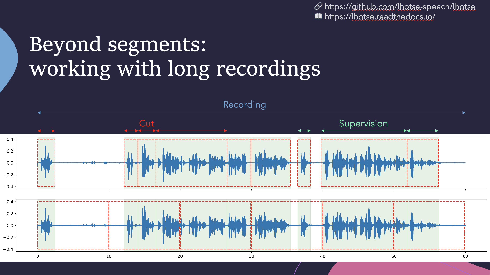
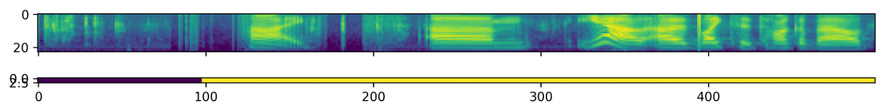

Getting started
===============


Lhotse is a Python library for preparing multimodal datasets and building scalable
PyTorch data pipelines. It provides manifests for audio, video, images, and text,
on-the-fly augmentation, dynamic batching, efficient sharded storage, and indexed,
resumable dataloading.


About
-----

Key features
************

* Multimodal recordings, supervision segments, images, and audio/video cuts.

* Lazy JSONL processing, filtering, mapping, shuffling, and dataset blending.

* On-the-fly augmentation with supervision timing updates, plus precomputed or
  on-the-fly feature extraction.

* Dynamic batching and bucketing, with data partitioning across distributed
  ranks and dataloader workers to avoid overlapping samples.

* Modular, sharded sequential I/O with Lhotse Shar.

* Indexed manifests, packed shard indexes, and checkpointing for supported
  pipelines; see :doc:`indexed-manifests` for exact restore requirements.

* Standard data preparation recipes for commonly used corpora; see :doc:`corpus`.

Tutorials
*********

The notebooks in the `examples directory <https://github.com/lhotse-speech/lhotse/tree/master/examples>`_
can be read on GitHub or run in Colab. Check each notebook for its installation
and data requirements:

* `Basic complete Lhotse workflow <https://github.com/lhotse-speech/lhotse/blob/master/examples/00-basic-workflow.ipynb>`_ |tutorial00|

* `Transforming data with Cuts <https://github.com/lhotse-speech/lhotse/blob/master/examples/01-cut-python-api.ipynb>`_ |tutorial01|

* `WebDataset integration <https://github.com/lhotse-speech/lhotse/blob/master/examples/02-webdataset-integration.ipynb>`_ |tutorial02|

* `How to combine multiple datasets <https://github.com/lhotse-speech/lhotse/blob/master/examples/03-combining-datasets.ipynb>`_ |tutorial03|

* `Lhotse Shar: storage format optimized for sequential I/O and modularity <https://github.com/lhotse-speech/lhotse/blob/master/examples/04-lhotse-shar.ipynb>`_ |tutorial04|

* `Image and Video Support in Lhotse <https://github.com/lhotse-speech/lhotse/blob/master/examples/05-image-and-video-loading.ipynb>`_ |tutorial05|
  (video requires TorchCodec 0.10 or later and FFmpeg).

* `AIStore batch loading <https://github.com/lhotse-speech/lhotse/blob/master/examples/06-train-ais-batch.ipynb>`_ |tutorial06|
  (requires an AIStore endpoint; uploads 100 training and 20 development recordings
  to its own temporary bucket).

* `Resumable, indexed dataloading <https://github.com/lhotse-speech/lhotse/blob/master/examples/07-resumable-indexed-dataloading.ipynb>`_ |tutorial07|
  (``torchdata`` is needed for the optional multi-worker example).

.. |tutorial00| image:: https://colab.research.google.com/assets/colab-badge.svg
    :target: https://colab.research.google.com/github/lhotse-speech/lhotse/blob/master/examples/00-basic-workflow.ipynb
.. |tutorial01| image:: https://colab.research.google.com/assets/colab-badge.svg
    :target: https://colab.research.google.com/github/lhotse-speech/lhotse/blob/master/examples/01-cut-python-api.ipynb
.. |tutorial02| image:: https://colab.research.google.com/assets/colab-badge.svg
    :target: https://colab.research.google.com/github/lhotse-speech/lhotse/blob/master/examples/02-webdataset-integration.ipynb
.. |tutorial03| image:: https://colab.research.google.com/assets/colab-badge.svg
    :target: https://colab.research.google.com/github/lhotse-speech/lhotse/blob/master/examples/03-combining-datasets.ipynb
.. |tutorial04| image:: https://colab.research.google.com/assets/colab-badge.svg
    :target: https://colab.research.google.com/github/lhotse-speech/lhotse/blob/master/examples/04-lhotse-shar.ipynb
.. |tutorial05| image:: https://colab.research.google.com/assets/colab-badge.svg
    :target: https://colab.research.google.com/github/lhotse-speech/lhotse/blob/master/examples/05-image-and-video-loading.ipynb

.. |tutorial06| image:: https://colab.research.google.com/assets/colab-badge.svg
    :target: https://colab.research.google.com/github/lhotse-speech/lhotse/blob/master/examples/06-train-ais-batch.ipynb
.. |tutorial07| image:: https://colab.research.google.com/assets/colab-badge.svg
    :target: https://colab.research.google.com/github/lhotse-speech/lhotse/blob/master/examples/07-resumable-indexed-dataloading.ipynb


Examples of use
***************

Check out the following links to see how Lhotse is being put to use:

* `Icefall recipes`_: where k2 and Lhotse meet.

* `NVIDIA NeMo <https://docs.nvidia.com/nemo/speech/nightly/dataloaders.html>`_:
  Lhotse dataloading with dynamic batching, dataset mixing, and Shar support.

* Minimal ESPnet+Lhotse example: |mini librispeech colab notebook|
  (Google sign-in may be required).

.. |mini librispeech colab notebook| image:: https://colab.research.google.com/assets/colab-badge.svg
    :target: https://colab.research.google.com/drive/1HKSYPsWx_HoCdrnLpaPdYj5zwlPsM3NH

Main ideas
**********

Lhotse shares its roots with `Kaldi`_ and works alongside `k2`_. It provides
standard data preparation recipes and PyTorch integration through task-specific
Dataset classes. The data and metadata are represented in human-readable text
manifests and exposed through Python classes.



Lhotse introduces the notion of audio cuts, designed to ease the training data construction with operations such as mixing, truncation and padding that are performed on-the-fly to minimize the amount of storage required. Data augmentation and feature extraction are supported both in pre-computed mode, with highly-compressed feature matrices stored on disk, and on-the-fly mode that computes the transformations upon request. Additionally, Lhotse introduces feature-space cut mixing to make the best of both worlds.



Installation
------------

This documentation follows the development version on ``master``, which requires
Python 3.11 or later. Some APIs and extras may not yet be available in the latest
stable release; see `PyPI <https://pypi.org/project/lhotse/>`_ for that release's
Python requirements.

Pip
***

Lhotse is available on PyPI::

    python -m pip install lhotse

To install the latest, unreleased version, do::

    python -m pip install git+https://github.com/lhotse-speech/lhotse

Quick start
***********

Download the small public `YesNo corpus <https://www.openslr.org/1/>`_, prepare
its training split, and load a batch of audio and transcripts. No precomputed
features or worker processes are needed. The example is shared with the README:

.. literalinclude:: ../README.md
   :language: python
   :start-after: ```python
   :end-before: ```

``DynamicCutSampler`` streams the lazy manifest into batches with at most
60 seconds of audio.
``K2SpeechRecognitionDataset`` loads and pads waveforms when requested and does
not require k2 to be installed.

Development installation
************************

See :doc:`contributing` for the locked uv environment, system dependencies,
tests, formatting, documentation builds, accelerator environments, dependency
updates, and releases.

Shar object store discovery
***************************

Shar directory discovery accepts ``CutSet.from_shar(in_dir="ais://bucket/prefix")``
and ``s3://`` prefixes (``s3a://`` and ``s3n://`` aliases normalize to ``s3://``).
Only immediate children are included; ``.idx``, ``.gzidx`` and ``.idxpack`` files
are excluded. With the AIStore SDK installed and ``AIS_ENDPOINT`` configured,
discovery uses AIStore, including for S3. Otherwise S3 discovery requires
``pip install boto3`` and uses its standard credential configuration.
Sidecar indexes, ``index_path`` and ``indexes_root`` use the same discovered
shard URLs as explicit ``fields``. Index packs retain their existing local-shard
requirement and source identifiers.

Environment variables
*********************

Lhotse uses several environment variables to customize its behavior. They are as follows:

* ``LHOTSE_REQUIRE_TORCHAUDIO`` is obsolete and has no effect; torchaudio is optional.

* ``LHOTSE_AUDIO_DURATION_MISMATCH_TOLERANCE`` - used when we load audio from a file and receive a different number of samples than declared in ``Recording.num_samples``. This is sometimes necessary because different codecs (or even different versions of the same codec) may use different padding when decoding compressed audio. Typically values up to 0.1, or even 0.3 (second) are still reasonable, and anything beyond that indicates a serious issue.

* ``LHOTSE_AUDIO_BACKEND`` - may be set to any of the values returned from CLI ``lhotse list-audio-backends`` to override the default behavior of trial-and-error and always use a specific audio backend.

* ``LHOTSE_IO_BACKEND`` - may be set to any of the values returned from CLI ``lhotse list-io-backends`` to override how Lhotse opens paths, URLs, and URIs via ``open_best()`` (for example when reading manifests or URL-backed ``AudioSource`` objects). The same list is also available in Python via ``lhotse.available_io_backends()``.

* ``LHOTSE_S3_LOCAL_MIRROR_ROOTS`` - optional ``os.pathsep``-separated local
  roots (``:`` on Unix, ``;`` on Windows) used to resolve URL-backed audio
  without rewriting ``s3://bucket/key`` paths in manifests. Roots are searched
  in order using the layout ``<root>/<bucket>/<key>``; archive-member URLs
  require only the local archive to exist. Missing objects retain their
  original URI and use the configured remote backend. ``AISBatchLoader``
  excludes successfully mirrored audio from AIStore requests.

* ``LHOTSE_RESAMPLING_BACKEND`` - may be set to any of the value returned from CLI ``lhotse list-resampling-backends`` to override the default behavior.

* ``LHOTSE_FEATURES_STORAGE_BACKEND`` overrides the default feature storage
  backend (``numpy_files``). Use ``lhotse.available_storage_backends()`` for
  usable choices, or ``lhotse.storage_backend_statuses()`` / CLI
  ``lhotse list-storage-backends`` for all backends and their installation hints.
  With ``lilcom`` installed, ``lilcom_chunky`` is the preferred compressed backend.

* ``LHOTSE_AUDIO_LOADING_EXCEPTION_VERBOSE`` - when set to 1 we'll emit full exception stack traces when every available audio backend fails to load a given file (they might be very large).

* ``LHOTSE_DILL_ENABLED`` - when it's set to ``1|True|true|yes``, we will enable ``dill``-based serialization of ``CutSet`` and ``Sampler`` across processes (it's disabled by default even when ``dill`` is installed).

* ``LHOTSE_LEGACY_OPUS_LOADING`` - (``=1``) reverts to a legacy OPUS loading mechanism that triggered a new ffmpeg subprocess for each OPUS file.

* ``LHOTSE_PREPARING_RELEASE`` - used internally by developers when releasing a new version of Lhotse.

* ``TORCHAUDIO_USE_BACKEND_DISPATCHER`` - when set to 1 and torchaudio version is below 2.1, we'll enable the experimental ffmpeg backend of torchaudio.

* ``AIS_ENDPOINT`` is read by AIStore client to determine AIStore endpoint URL. Required for AIStore dataloading.

* ``AIS_CONNECT_TIMEOUT`` - used by AIStore SDK to set the connection timeout (in seconds) for AIStore client requests. Set to ``0`` to disable (no timeout). If not set, the SDK default is used (3s).

* ``AIS_READ_TIMEOUT`` - used by AIStore SDK to set the read timeout (in seconds) for AIStore client requests. Set to ``0`` to disable (no timeout). If not set, the SDK default is used (20s).

* ``RANK``, ``WORLD_SIZE``, ``WORKER``, and ``NUM_WORKERS`` are internally used to inform Lhotse Shar dataloading subprocesses.

* ``READTHEDOCS`` is internally used for documentation builds.

* ``LHOTSE_MSC_OVERRIDE_PROTOCOLS`` selects a comma-separated list of URL schemes
  to route through ``MSCIOBackend`` without changing manifests. For example,
  ``LHOTSE_MSC_OVERRIDE_PROTOCOLS=s3,gs`` routes ``s3://bucket/key`` and
  ``gs://bucket/key`` through ``msc://bucket/key``.

* ``LHOTSE_MSC_PROFILE`` overrides the bucket name with an MSC profile. With
  ``LHOTSE_MSC_OVERRIDE_PROTOCOLS=s3`` and ``LHOTSE_MSC_PROFILE=msc-s3-profile``,
  ``s3://bucket/key`` becomes ``msc://msc-s3-profile/key``.

* ``LHOTSE_MSC_BACKEND_FORCED=True`` forces ``MSCIOBackend`` for all URLs. The
  configured MSC client must support their formats.

Optional dependencies
*********************

**Other pip packages.** Install the supporting packages needed for your workflow.
The extras below describe ``master``. For development-only extras, include them
in the source installation::

    python -m pip install 'lhotse[checkpoint,gzip] @ git+https://github.com/lhotse-speech/lhotse'

* ``python -m pip install "lhotse[checkpoint]"`` installs ``torchdata`` for
  multi-worker checkpointing with ``torchdata.stateful_dataloader.StatefulDataLoader``.

* ``python -m pip install "lhotse[gzip]"`` enables indexed gzip JSONL. Keep both
  ``.idx`` and ``.gzidx`` sidecars with the source; see :doc:`indexed-manifests`.

* ``python -m pip install "lhotse[pillow]"`` enables image loading with Pillow.

* ``python -m pip install "lhotse[lilcom]"`` to enable lilcom-compressed feature and array storage backends. If storage efficiency is important, ``lilcom_chunky`` is the preferred feature-storage backend once this dependency is installed.

* ``torchcodec`` (>= 0.10) is supported as an audio and video backend when detected; older versions are ignored. It is a PyTorch-native audio decoder built on FFmpeg. Install it via ``python -m pip install torchcodec``. When installed, it takes precedence over torchaudio in the default backend chain. Without it, Lhotse can still read video with torchaudio < 2.9 and FFmpeg.

* ``torchaudio`` used to be a core dependency in Lhotse, but is now optional. Refer to official PyTorch documentation for installation at `official Pytorch documentation for installation`_.

* ``python -m pip install "lhotse[kaldi]"`` for a maximal feature set related to Kaldi compatibility. It includes libraries such as ``kaldi_native_io`` (a more efficient variant of ``kaldi_io``) and ``kaldifeat`` that port some of Kaldi functionality into Python.

* ``python -m pip install "lhotse[orjson]"`` for faster JSONL serialization and reading.

* ``python -m pip install "lhotse[webdataset]"``. We support "compiling" your data into WebDataset tarball format for more effective IO. You can still interact with the data as if it was a regular lazy CutSet. To learn more, check out the following tutorial: |tutorial02|

* ``python -m pip install h5py`` if you want to extract speech features and store them as HDF5 arrays.

* ``python -m pip install "lhotse[dill]"`` installs support for serializing lazy transforms
  such as lambdas in ``CutSet.map()`` or ``CutSet.filter()``. Dill is disabled by
  default even when installed: also set ``LHOTSE_DILL_ENABLED=1`` or call
  ``lhotse.set_dill_enabled(True)``. This can help with serialization in a PyTorch
  ``DataLoader`` with ``num_workers > 0``.

* ``python -m pip install aistore`` to read manifests, tar files, and other data from AIStore using AIStore-supported URLs (set ``AIS_ENDPOINT`` environment variable to activate it). See `AIStore`_ for more details.

* ``python -m pip install smart_open`` to read and write manifests and data in any location supported by ``smart_open`` (e.g. cloud, http).

* ``python -m pip install opensmile`` for feature extraction using the OpenSmile toolkit's Python wrapper.

* ``python -m pip install multi-storage-client`` for reading and writing data in
  multiple storage backends. See `Multi-Storage Client <https://github.com/NVIDIA/multi-storage-client>`_.

**sph2pipe.** For reading older LDC SPHERE (.sph) audio files that are compressed with codecs unsupported by ffmpeg and sox, please run::

    # CLI
    lhotse install-sph2pipe

    # Python
    from lhotse.tools import install_sph2pipe
    install_sph2pipe()

It will download it to ``~/.lhotse/tools``, compile it, and auto-register in ``PATH``. The program should be automatically detected and used by Lhotse.


Examples
--------

The following voice activity detection example requires a licensed Switchboard
corpus at the specified path. For a public-data example, use the quick start above.

We have example recipes showing how to prepare data and load it in Python as a PyTorch ``Dataset``.
They are located in the ``examples`` directory.

A short snippet to show how Lhotse can make audio data preparation quick and easy:

.. code-block:: python

    from torch.utils.data import DataLoader
    from lhotse import CutSet, Fbank
    from lhotse.dataset import VadDataset, SimpleCutSampler
    from lhotse.recipes import prepare_switchboard

    # Prepare data manifests from a raw corpus distribution.
    # The RecordingSet describes the metadata about audio recordings;
    # the sampling rate, number of channels, duration, etc.
    # The SupervisionSet describes metadata about supervision segments:
    # the transcript, speaker, language, and so on.
    swbd = prepare_switchboard('/export/corpora3/LDC/LDC97S62')

    # CutSet is the workhorse of Lhotse, allowing for flexible data manipulation.
    # We create 5-second cuts by traversing SWBD recordings in windows.
    # No audio data is actually loaded into memory or stored to disk at this point.
    cuts = CutSet.from_manifests(
        recordings=swbd['recordings'],
        supervisions=swbd['supervisions']
    ).cut_into_windows(duration=5)

    # We compute the log-Mel filter energies and store them on disk;
    # Then, we pad the cuts to 5 seconds to ensure all cuts are of equal length,
    # as the last window in each recording might have a shorter duration.
    # The padding will be performed once the features are loaded into memory.
    cuts = cuts.compute_and_store_features(
        extractor=Fbank(),
        storage_path='feats',
        num_jobs=8
    ).pad(duration=5.0)

    # Construct a Pytorch Dataset class for Voice Activity Detection task:
    dataset = VadDataset()
    sampler = SimpleCutSampler(cuts, max_duration=300)
    dataloader = DataLoader(dataset, sampler=sampler, batch_size=None)
    batch = next(iter(dataloader))

The ``VadDataset`` will yield a batch with pairs of feature and supervision tensors such as the following -
the speech starts roughly at the first second (100 frames):




.. _k2: https://github.com/k2-fsa/k2
.. _Kaldi: https://github.com/kaldi-asr/kaldi
.. _Icefall recipes: https://github.com/k2-fsa/icefall
.. _orjson: https://pypi.org/project/orjson/
.. _AIStore: https://aiatscale.org
.. _official Pytorch documentation for installation: https://pytorch.org/get-started/locally/
